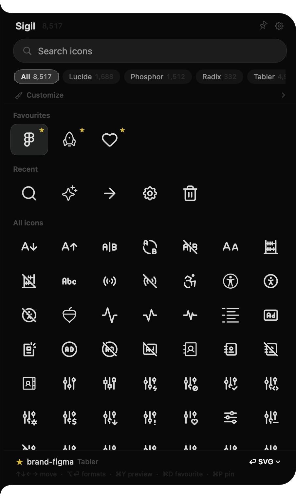

# Sigil

Find an icon and paste it in the format you need, without leaving the app you're in.

Sigil is a macOS app that slides a drawer out of the edge of your screen. Press the shortcut, type what you want, press Return, and the icon is on your clipboard. It bundles 8,517 icons from Lucide, Phosphor, Radix and Tabler, and you can add your own.



## Install

[Download Sigil.dmg](https://github.com/bt-vdla/sigil/raw/main/Sigil.dmg), open it, and drag Sigil to Applications. It needs macOS 15 or later and runs on Apple Silicon and Intel.

Sigil isn't notarized by Apple yet, so macOS blocks it the first time you open it. To allow it:

1. Open Sigil and dismiss the warning.
2. Go to System Settings, then Privacy & Security.
3. Scroll down and choose Open Anyway next to the message about Sigil.

## Using it

Press **⌃⇧Space** from anywhere to open or close the drawer. You can change the shortcut in Settings, and also choose whether the drawer opens from the left or right edge.

Clicking anywhere outside closes the drawer. Pin it when you want it to stay open, for example while you drag icons into Figma.

If you reopen within 30 seconds, your last search is still there. After that it starts empty. Your pack filter, colour and stroke settings stay as you left them.

| Key | What it does |
| --- | --- |
| Arrow keys | Move through the icons |
| Return | Copy, then close |
| ⌘Return | Copy and stay open |
| ⌥Return | Choose a format |
| Esc | Clear the search, then the selection, then close |
| ⌘D | Add or remove a favourite |
| ⌘Y | Large preview, with the same icon from other packs |
| ⌘P | Pin the drawer |
| ⌘← and ⌘→ | Step through packs |
| ⌘0 | Clear the pack filter |
| ⌘+ and ⌘− | Change the grid size |
| ⌘, | Settings |

Click an icon to copy it, or ⌘-click to select several and copy them together. You can also drag icons straight into other apps.

## Search

Search understands what you mean as well as what an icon is called. "delete" finds trash, "close" finds x, and typos like "trahs" still work. It uses the tags each pack publishes plus a list of common synonyms. Several words narrow the results, so "arrow left circle" has to match all three.

Separate names with commas to pull up a set at once: `trash, settings, user`.

Your favourites and recent icons appear first when the search is empty, and rank higher in results.

## Copy formats

| Format | What you get |
| --- | --- |
| SVG | Clean markup, without XML headers or comments |
| Component | `<Trash2 strokeWidth={1.5} />` with your colour and stroke as props |
| Import line | `import { Trash2 } from "lucide-react";` |
| Inline TSX | A typed React component with `{...props}` passed through |
| PNG @1x, @2x, @3x | Transparent, at exactly 48, 96 or 144 pixels |
| CSS data URI | `url("data:image/svg+xml,…")` for backgrounds and masks |
| File | An SVG file, with a PNG for apps that only accept images |

Component and Import line work for the four bundled packs, using `lucide-react`, `@tabler/icons-react`, `@phosphor-icons/react` and `@radix-ui/react-icons`.

Sigil remembers the format you last picked in each app. Choose Component once in Cursor, and Return gives you a component there from then on. The footer always shows what Return will copy.

## Your own icons

In Settings, add a pack from a folder of SVGs, a GitHub repository or subfolder, an npm package name, or a link to a `.zip`. Icons that share a filename across folders, such as outline and solid versions, are all kept. Black fills are converted to `currentColor` so the colour picker works on them.

Sigil only uses the network when you import a pack from a link.

## Building from source

You need Xcode 16 or later. To run it, open `Sigil.xcodeproj`, or build from the command line:

```bash
xcodebuild -project Sigil.xcodeproj -scheme Sigil -configuration Debug build
```

To rebuild `Sigil.dmg` at the repo root (without a Developer ID certificate, use `--unsigned`):

```bash
./scripts/make-dmg.sh --unsigned
```

The Xcode project is generated from `project.yml`. After adding or removing source files:

```bash
xcodegen generate
```

To refresh the search tags after updating the bundled icons:

```bash
python3 scripts/build-tags.py
```

## Licences

Sigil is MIT licensed. The bundled icons belong to their authors:

| Pack | Icons | Licence |
| --- | --- | --- |
| [Lucide](https://lucide.dev) | 1,688 | ISC |
| [Phosphor](https://phosphoricons.com) | 1,512 | MIT |
| [Radix](https://www.radix-ui.com/icons) | 332 | MIT |
| [Tabler](https://tabler.io/icons) | 4,985 | MIT |
